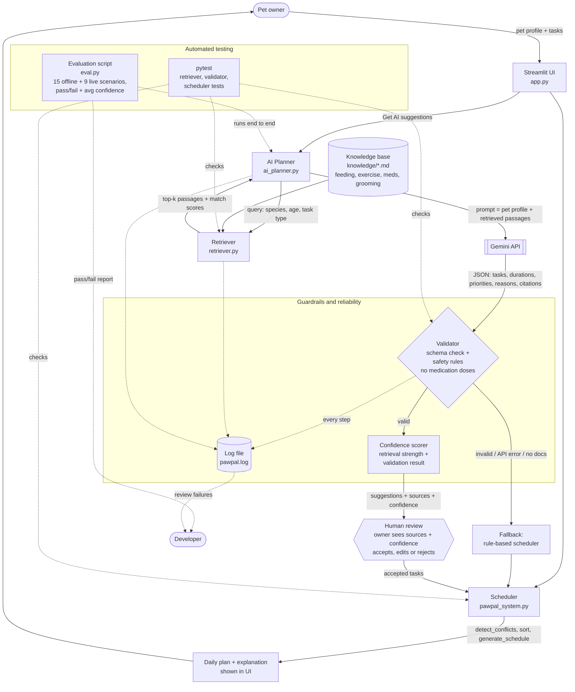

# PawPal+ AI: A Retrieval-Augmented Pet Care Planner

> **Status:** the RAG planner, guardrails, evaluation harness and UI are built and tested: 35 unit tests, 15 offline scenarios and 9 live Gemini scenarios all pass. The responsible-AI write-up is in [model_card.md](model_card.md).

## Original project

This builds on **PawPal+ (Module 2)**, a Streamlit app that helps a busy pet owner plan daily care. The original system modeled owners, pets and tasks (`Owner`, `Pet`, `Task`) and a `Scheduler` that sorted tasks by time, filtered them by pet and status, detected same-time conflicts, handled daily and weekly recurrence, and produced a priority-aware daily plan. It had a 7-test pytest suite and a Streamlit UI. Full documentation of that version is in [docs/pawpal_core_reference.md](docs/pawpal_core_reference.md).

## Summary: what this project does and why it matters

The original PawPal+ schedules whatever tasks the owner types in, but it has no idea what a pet actually needs. A new owner of a 10-year-old dog won't know that older dogs need shorter walks and joint support, or how often a cat needs grooming.

PawPal+ AI adds a **retrieval-augmented planner**. It looks up pet-care guidance for the pet's species, age and task type from a local knowledge base. It then asks Gemini to propose tasks, durations and priorities grounded in those passages, with citations. The suggestions pass through validation and safety guardrails and get a confidence score. The owner reviews them before anything is added to the schedule. If the AI is unavailable or the output is invalid, the app falls back to the original rule-based scheduler.

The retrieved text changes what gets scheduled and how it is explained. It is not shown beside a generic answer.

## Architecture overview

The diagram below renders on GitHub. Its source is [diagrams/system_diagram.mmd](diagrams/system_diagram.mmd).



| Component | File | Role |
|-----------|------|------|
| Streamlit UI | `app.py` | Collects pet/task input, shows suggestions with sources and confidence, and holds the human-review step |
| Retriever | `retriever.py` | Scores passages in `knowledge/*.md` against the pet's species, age and task type and returns the top-k |
| AI Planner | `ai_planner.py` | Builds a prompt from the pet profile and retrieved passages, calls Gemini and parses the JSON reply |
| Validator | `ai_planner.py` | Checks schema (valid priority, positive duration, valid time) and safety rules (no medication doses) |
| Confidence scorer | `ai_planner.py` | Combines retrieval strength and validation outcome into a 0-1 score |
| Scheduler | `pawpal_system.py` | Existing logic: sorting, conflicts, recurrence, daily plan; also the fallback path |
| Tests | `tests/`, `eval.py` | pytest unit tests plus an evaluation over 15 offline and 9 live scenarios |
| Logging | `pawpal.log` (created at runtime) | Records retrieval hits, API calls, validation failures and fallbacks |

**Data flow:** owner input → retriever → planner (prompt with retrieved passages) → Gemini → validator → confidence scorer → **human review** → scheduler → daily plan with explanations. Any validation failure, API error or empty retrieval routes to the rule-based fallback.

**Where humans and tests check the AI:**
- *Human:* the owner sees each suggestion with its source citation and confidence and can accept, edit or reject it.
- *Automated:* pytest covers the retriever, validator and scheduler. `eval.py` runs full scenarios and reports pass/fail and average confidence.

## Setup instructions

Requires Python 3.10+.

```bash
git clone <this-repo-url>
cd applied-ai-system-project

python -m venv .venv
source .venv/bin/activate        # Windows: .venv\Scripts\activate
pip install -r requirements.txt

cp .env.example .env             # then edit .env and set GEMINI_API_KEY (optional)
```

Run the app:

```bash
streamlit run app.py
```

Run the CLI demo of the scheduler:

```bash
python main.py
```

Run the tests:

```bash
python -m pytest
python eval.py                   # offline evaluation (retrieval, guardrails, fallbacks)
python eval.py --live            # also run scenarios through the real Gemini API
```

Without an API key the app still works. It uses the original rule-based scheduler.

## Sample interactions

The first three are real output captured from the code in this repo with no API key set. Those paths (retrieval, guardrails, fallback) don't call the model.

**1. Retrieval for a senior dog.** Input: Mochi, dog, age 11, focus "exercise walk".
```
0.6179  general_routine.md#Walk timing
0.1518  dog_exercise.md#Senior dog exercise
0.1223  dog_exercise.md#Puppy exercise
```
The senior passage outranks the puppy passage because the pet's life stage boosts matching headings. The planner passes these three passages to Gemini.

**2. Unsafe request blocked.** Input: "how much ibuprofen can I give?"
```
Blocked: I can't recommend medication or doses. Please contact your veterinarian or an
emergency vet, who can advise based on your pet's weight and health.
```
The model is never called.

**3. No relevant guidance.** Input: cat, focus "swimming lessons" → `No relevant care guidance found, so no AI suggestions were made.` With no API key set, a normal request gives `No API key set, so AI suggestions are unavailable.` In both cases the app keeps working through the original scheduler.

**4. Live Gemini suggestions for a senior dog.** Input: Mochi, Shiba Inu, age 11, focus "exercise walk". Real output from `gemini-3.5-flash-lite`, confidence 100%, 0 rejected:
```
08:00  Morning Walk    20 min  high    daily   [dog_exercise.md#Senior dog exercise]
       Since Mochi is an 11-year-old senior dog, this shorter, gentler walk helps maintain muscle and joint mobility.
14:00  Afternoon Walk  20 min  medium  daily   [dog_exercise.md#Senior dog exercise]
       As a senior dog, Mochi benefits from two or three shorter walks a day instead of one long outing.
18:00  Evening Walk    20 min  medium  daily   [dog_exercise.md#Senior dog exercise]
       Providing a third gentle walk for senior dogs like Mochi helps support joint mobility and overall movement.
```
The durations (20 min) and the "two or three shorter walks" pattern come from the retrieved senior-dog passage, not from the model's general knowledge. In the UI the owner ticks which of these to add to the schedule.

The original scheduler behavior is demonstrated in [docs/pawpal_core_reference.md](docs/pawpal_core_reference.md#sample-cli-output).

## Design decisions

- **RAG over fine-tuning or plain prompting.** Pet-care guidance is factual and should be traceable. Retrieval lets every suggestion cite a source and lets me update knowledge by editing a markdown file.
- **Simple keyword/TF-IDF retrieval, not a vector database.** The knowledge base is small, so the dependency and setup cost of embeddings isn't worth it. The trade-off is weaker handling of synonyms and paraphrases.
- **Human in the loop.** AI output never reaches the schedule without owner approval, because pet health is a domain where confident-sounding mistakes matter.
- **Fallback to the rule-based scheduler.** The app stays useful with no API key, no network or bad model output. The trade-off is extra code paths to test.
- **Structured JSON output with validation.** Free text can't be scheduled reliably. The cost is occasional rejected responses.
- **Keep the original scheduler intact.** The AI layer sits on top of `Scheduler` and doesn't replace it.

## Testing summary

**Unit tests:** `python -m pytest` runs 35 tests, all passing: the 7 original scheduler tests plus 28 for the AI layer. They cover retrieval ranking and species filtering, the validator (11 malformed-suggestion cases), dose and safety rules, JSON parsing, confidence bounds, and the planner's fallbacks. They also check that retrieved text actually appears in the prompt, and that unsafe requests never reach the model.

**Evaluation script:** `python eval.py` passes 15/15 offline scenarios: 9 retrieval cases (expected passage in the top 3), 3 guardrail cases and 3 fallback cases. `python eval.py --live` adds 9 end-to-end runs through the real Gemini API, and all 9 pass (at least one suggestion, every citation is a retrieved passage, no doses). Average confidence was 0.98, ranging from 0.89 to 1.0, with 0 suggestions rejected. Total: 24/24.

**What worked:** life-stage weighting fixed an early problem where an 11-year-old dog's senior passage didn't beat the puppy passage. Excluding the species name from the query terms fixed irrelevant queries like "swimming lessons" returning cat passages.

**What didn't, and known limits:**
- **Model availability:** my first model choice (`gemini-2.5-flash`) had been retired for new users, and `gemini-3.8-flash` timed out under load. I found this from `pawpal.log`, because the app showed only a generic "AI step failed" message. The fix was a faster default (`gemini-3.5-flash-lite`), a 30 s request timeout and retries on temporary errors. The app now degrades to the rule-based scheduler instead of hanging.
- **Confidence is not very discriminating:** in live runs it was almost always near 1.0, because the model rarely broke the rules and the retrieval scores were high. It only drops meaningfully when output is partly invalid (see the offline guardrail test, 0.62). A better signal would need human ratings of suggestion quality.
- General short passages such as "Walk timing" can outrank species-specific ones, because TF-IDF favors short text. The right passage is still in the top 3, but not always first.
- Retrieval is keyword-based, so paraphrases ("stroll" for "walk") can miss.
- The dose filter is a regex, so it catches common phrasing ("5 mg", "half a tablet") but not every possible one.
- The offline evaluation checks retrieval and guardrail logic, not the quality of the model's wording. That needs the live run and human judgment.
- Existing scheduler gaps remain: conflicts compare start times only, not overlapping durations.

**What I learned:** most of the reliability came from the code around the model, not the model. Validating output, citing retrieved sources and defining fallbacks were what made behavior testable.

## Reflection

Building the retrieval step showed me how much an LLM's answer depends on what it is given. With the senior-dog passage in the prompt, Gemini suggested three 20-minute walks and explained that older dogs do better with shorter outings. That came from the passage, not from the model's general knowledge. When retrieval ranked the wrong passage first (the puppy passage beat the senior one for an 11-year-old dog), the suggestions would have been worse, so most of my debugging went into retrieval rather than prompts.

Validation and logging caught things I would not have noticed by reading output. The log showed that a retired model name and a slow model were the real cause of a vague "AI step failed" message. The tests showed that a keyword retriever returned cat passages for "swimming lessons" until I removed the species name from the query terms.

The bigger lesson is that most of the reliability came from the code around the model: validating output, citing sources, falling back to the original scheduler and keeping the owner in the loop. Confidence scores were less useful than I expected, because they stayed near 1.0 and only measured well-formedness, not quality. If I did it again I would get a vet or experienced owner to rate sample suggestions early, and I would test retrieval with paraphrased queries from the start.

My collaboration with AI, an accepted and a revised suggestion, and the system's limitations are in [model_card.md](model_card.md).

## Project structure

```
app.py                 Streamlit UI
pawpal_system.py       Task, Pet, Owner, Scheduler (original core)
main.py                CLI demo
tests/                 pytest suite
diagrams/              system diagram, UML (draft and final), architecture
docs/                  reference docs for the original PawPal+ project
knowledge/             pet-care documents used for retrieval
retriever.py           passage retrieval (TF-IDF + life-stage weighting)
ai_planner.py          prompt, Gemini call, validation, guardrails, confidence
eval.py                evaluation harness (offline, plus --live)
.env.example           template for GEMINI_API_KEY
model_card.md          responsible-AI reflection and limitations
```
